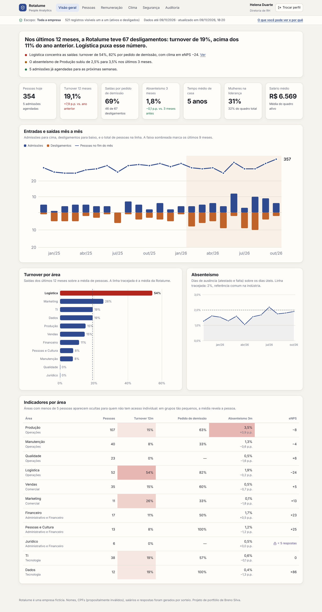
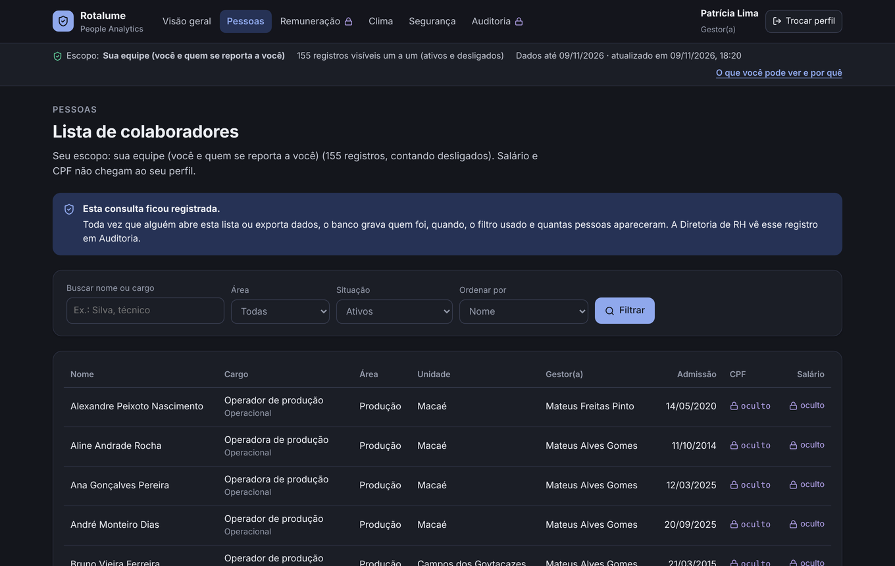
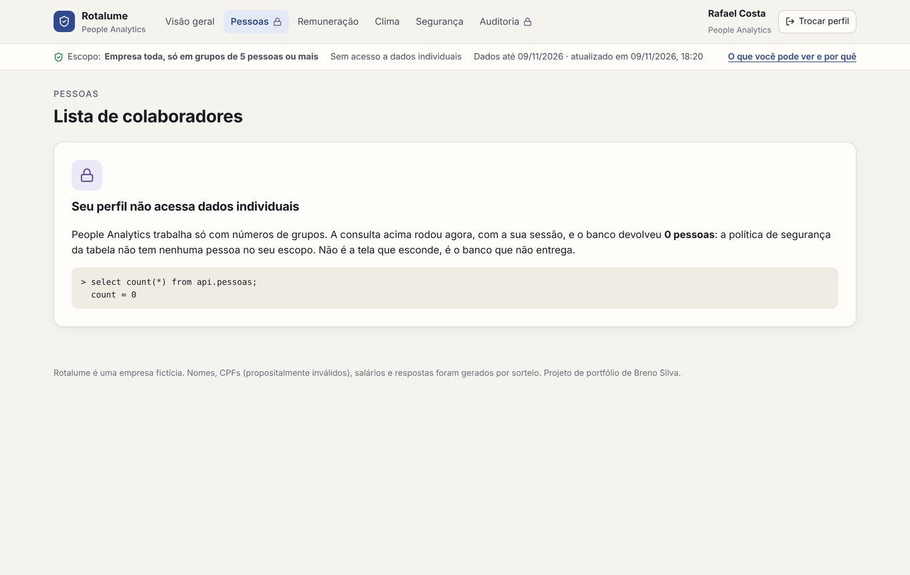
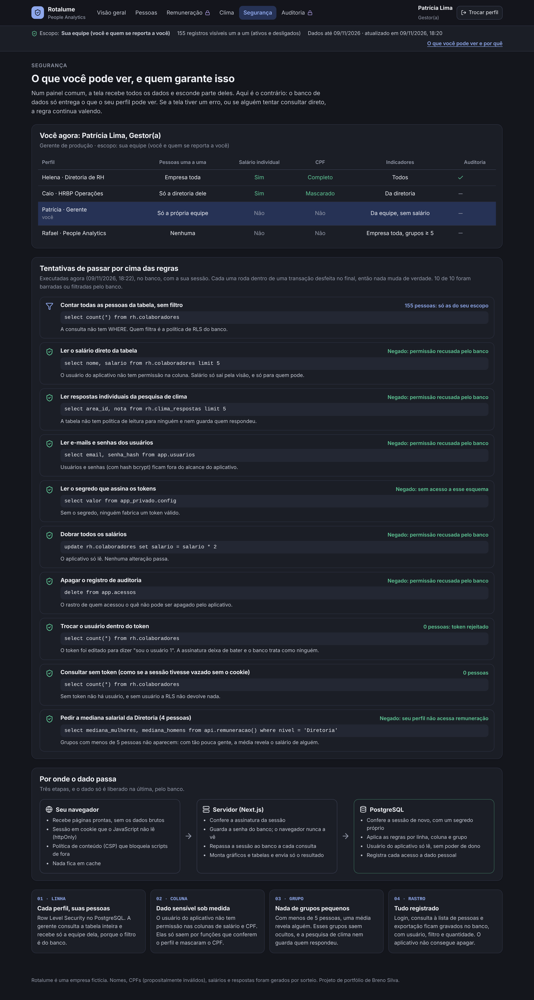
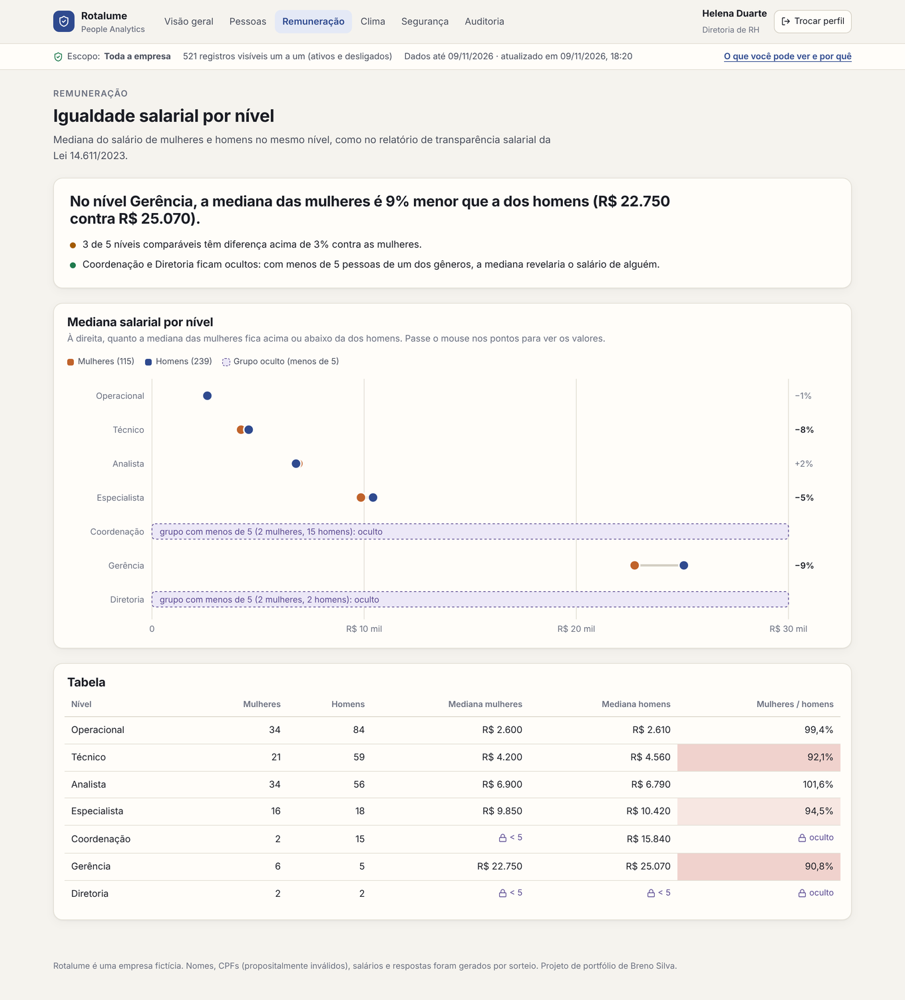

# Rotalume · People Analytics

**Um painel de RH em que o banco de dados decide o que cada pessoa vê.**

Turnover, absenteísmo, clima e igualdade salarial de uma empresa fictícia com 350 pessoas. Quatro perfis entram no mesmo painel e veem coisas diferentes, porque o PostgreSQL só entrega o que cada um pode ver. A tela não esconde nada: ela nem recebe.

> Projeto de portfólio de **Breno Silva**. Todos os dados são fictícios: nomes sorteados, CPFs propositalmente inválidos, salários e respostas gerados por simulação.



## A pergunta

Hoje é comum apresentar dados em uma página HTML. A dúvida que sempre aparece: **e a segurança?** Se o arquivo traz todos os dados e a tela só filtra, qualquer pessoa com o link vê tudo pelo código-fonte.

Este projeto mostra o outro caminho: a página é só a vitrine. Quem decide o que sai é o banco, com permissão por linha, por coluna e por tamanho de grupo, e cada acesso a dado pessoal fica registrado.

## Os quatro perfis

| Perfil | Pessoas uma a uma | Salário | CPF | Indicadores |
|---|---|---|---|---|
| **Helena** · Diretoria de RH | Empresa toda | Sim | Completo | Todos, mais auditoria |
| **Caio** · HR Business Partner | Só a Diretoria de Operações | Sim | Mascarado | Da diretoria |
| **Patrícia** · Gerente de Produção | Só a própria equipe | Não | Não | Da equipe, sem remuneração |
| **Rafael** · People Analytics | Nenhuma | Não | Não | Empresa toda, só grupos de 5 ou mais |

| Gerente: só a equipe, sem salário e CPF | Analista: o banco devolve 0 pessoas |
|---|---|
|  |  |

## As quatro camadas de proteção

| Camada | Como funciona | Onde está |
|---|---|---|
| **1. Linha** | Row Level Security no PostgreSQL. `select count(*) from rh.colaboradores`, sem `WHERE`, devolve (na instalação de exemplo) 521 registros para a diretoria, 342 para o HRBP, 155 para a gerente e 0 para o analista. | `db/03_seguranca.sql`, políticas `escopo` |
| **2. Coluna** | O usuário do aplicativo não tem permissão nas colunas `salario`, `cpf` e `nascimento`. Salário e CPF saem só por funções que conferem o perfil e mascaram o CPF. | `grant select (...)`, `app.salario_de`, `app.cpf_de` |
| **3. Grupo** | Grupos com menos de 5 pessoas saem vazios: em grupos tão pequenos, a média revela alguém. A pesquisa de clima nem guarda quem respondeu. | `api.remuneracao`, `api.clima`, `app.k_min()` |
| **4. Rastro** | Login, consulta à lista de pessoas e exportação ficam gravados com usuário, filtro e quantidade. O aplicativo não lê, não altera e não apaga o log. | `app.acessos`, `api.registrar`, página Auditoria |

### Como o banco sabe quem está pedindo

1. No login, o banco confere a senha (bcrypt) e bloqueia o e-mail depois de 5 erros em 15 minutos.
2. O servidor cria uma sessão `usuário.validade.assinatura` (HMAC-SHA256) e grava num cookie `httpOnly`. O JavaScript da página não consegue ler esse cookie.
3. A cada consulta, o servidor abre uma transação e repassa a sessão ao banco (`set_config('app.token', ..., true)`).
4. O banco confere a assinatura com um segredo guardado numa tabela que o usuário do aplicativo não consegue ler. Sessão trocada, vencida ou ausente vira "ninguém", e "ninguém" recebe zero linhas.

Ou seja: mesmo que alguém consiga rodar SQL com o usuário do aplicativo, sem o segredo não se passa por outra pessoa.

### A página Segurança prova tudo isso ao vivo

Ela roda 10 tentativas reais de burlar as regras com a sua sessão: ler salário direto da tabela, ler respostas do clima, ler senhas, dobrar salários, apagar a auditoria, trocar o usuário dentro da sessão, consultar sem sessão. Tudo dentro de uma transação desfeita no fim, então nada muda.



### Outras proteções da página

- **CSP com nonce:** só rodam os scripts do próprio aplicativo, e não há estilo inline.
- **Cabeçalhos de segurança:** `X-Frame-Options: DENY`, `nosniff`, `Referrer-Policy: no-referrer`, HSTS e `Cache-Control: no-store`, para que nenhuma página com dado pessoal fique em cache.
- **Server Components:** gráficos e tabelas são montados no servidor e o navegador recebe só o resultado, sem um JSON com as linhas do banco.
- **Exportação CSV:** só para quem pode, registrada, e protegida contra injeção de fórmula no Excel.

## O que os dados contam

Os dados são simulados dia a dia por 3 anos, com uma história plantada para o painel encontrar:

- **Logística (Macaé) perde gente cada vez mais rápido:** turnover de cerca de 50% em 12 meses, 8 em cada 10 saídas por pedido de demissão, e o clima da área caiu ciclo a ciclo.
- **O absenteísmo da Produção subiu** nos últimos 4 meses.
- **Igualdade salarial (Lei 14.611/2023):** mulheres ganham menos que homens no mesmo nível em vários níveis, e são minoria na liderança.

Como a simulação é diária, os números exatos mudam conforme a data de instalação, mas a história se mantém.



## Atualização dos dados

Um agendamento da Vercel (`vercel.json`) chama `/api/cron` todo dia às 6h (horário de Brasília). A rota só aceita a chamada com o `CRON_SECRET`, e o banco processa os dias que faltam: ausências, desligamentos com reposição e vagas novas. A Diretoria de RH também tem um botão "Atualizar agora".

## Stack

- **Next.js 16** (App Router, Server Components, Server Actions, Proxy) + **React 19** + **TypeScript**
- **PostgreSQL 16**: RLS, privilégios por coluna, funções `security definer`, `pgcrypto` (bcrypt e HMAC), PL/pgSQL
- Gráficos em **SVG próprio**, desenhados no servidor
- **Vitest**: 19 testes de segurança rodando contra um Postgres real
- **GitHub Actions**: sobe um Postgres, instala o banco e roda tipos, testes e build
- Deploy: **Vercel** + **Neon** (Postgres gerenciado, plano gratuito)

## Estrutura

```
db/
  01_estrutura.sql    tabelas (rh, app, app_privado, api)
  02_dados.sql        simulação dos dados fictícios
  03_seguranca.sql    RLS, permissões, funções da API do banco
  04_finalizar.sql    gera os dados, o segredo e a senha do rh_app
  instalar.sql        os quatro juntos (gerado por scripts/montar-sql.sh)
lib/
  token.ts            assinatura da sessão
  db.ts               conexão como rh_app, sessão repassada por transação
  dados.ts            chamadas às funções do banco
  provas.ts           as tentativas de burla da página Segurança
  leitura.ts          transforma os números nas frases do topo
app/                  páginas (login, visão geral, pessoas, remuneração, clima, segurança, auditoria)
proxy.ts              sessão obrigatória e cabeçalhos de segurança
tests/                testes de segurança
```

## Como rodar

Publicar na internet: veja [docs/PUBLICAR.md](docs/PUBLICAR.md) (Neon + Vercel, cerca de 15 minutos).

Localmente, com um PostgreSQL 16:

```bash
npm install
bash scripts/montar-sql.sh
createdb rh_teste
psql -d rh_teste -f db/instalar.sql      # mostra a senha do rh_app e o token_secret no final
cp .env.example .env.local               # preencha com os valores acima
npm test                                 # testes de segurança
npm run dev
```

Senha de todos os perfis de demonstração: `rotalume-demo`.

## Outros projetos

- [SGQ Rotalume · Sistema de gestão da qualidade](https://github.com/Oberon-23/SGQ-Rotalume)
- [Portfólio](https://portfolio-two-blond-10.vercel.app)
